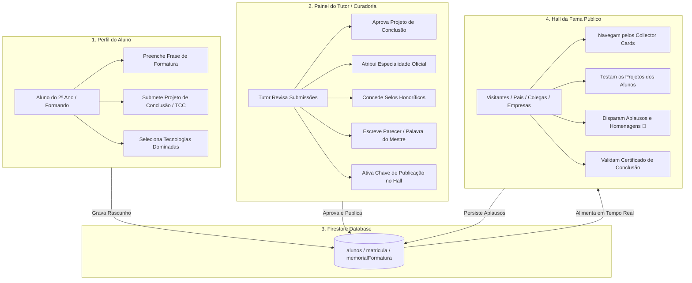

# 🏛️ Arquitetura e Roadmap: Hall da Fama (Trilha Tech)

Este documento registra a **arquitetura lógica completa**, o **modelo de dados**, os **contratos de API** e o **roadmap passo a passo** do **Hall da Fama** da Trilha Tech (EREM).

Ele serve como o guia definitivo para saber:
1. **Onde o projeto começou.**
2. **O que já está implementado e funcional.**
3. **Onde paramos e de onde devemos continuar.**

---

## 📌 Status Atual do Projeto (Tracking)

| Etapa | Componente / Funcionalidade | Status | Arquivo Principal |
| :--- | :--- | :---: | :--- |
| **Design** | Mockups Visuais Conceituais (UI de Alta Fidelidade) | ✅ Concluído | `hall_formandos_conquistas_*.jpg` |
| **Frontend** | Página Pública do Hall da Fama (`/hall-da-fama`) | ✅ Concluído | `src/app/hall-da-fama/page.tsx` |
| **Frontend** | Pódio 3D, Collector Cards, Filtros e Botão de Aplausos | ✅ Concluído | `src/app/hall-da-fama/page.tsx` |
| **Frontend** | Hero Banner de Destaque no Dashboard do Aluno | ✅ Concluído | `src/app/portal/page.tsx` |
| **Etapa 1** | Modelagem de Dados no Firestore (`memorialFormatura`) | ⏳ **A Iniciar** | `src/types/index.ts` |
| **Etapa 1** | Aba/Modal "Memorial de Formatura" no Perfil do Aluno | ⏳ **A Iniciar** | `src/components/PerfilModal.tsx` |
| **Etapa 1** | Rotas de API para Aluno salvar frase, projeto e stack | ⏳ **A Iniciar** | `src/app/api/alunos/memorial/route.ts` |
| **Etapa 2** | Aba "Curadoria do Hall da Fama" no Painel do Tutor | ⏳ Pendente | `src/app/trilhatech/page.tsx` |
| **Etapa 2** | API do Tutor para aprovação, selos de honra e parecer | ⏳ Pendente | `src/app/api/tutor/memorial/route.ts` |
| **Etapa 3** | Persistência real de aplausos no Firestore | ⏳ Pendente | `src/app/api/hall-da-fama/aplaudir/route.ts` |
| **Etapa 3** | Modal de Certificado Digital Verificável | ⏳ Pendente | `src/components/CertificadoModal.tsx` |
| **Etapa 3** | Gerador de Card para Story (Instagram/WhatsApp) | ⏳ Pendente | `src/components/CardCompartilharModal.tsx` |

---

## 🏗️ Os 3 Lados da Arquitetura Lógica



---

## 💾 Modelo de Dados no Firestore (`MemorialFormatura`)

O objeto `memorialFormatura` é incorporado diretamente no documento do aluno em `alunos/{matricula}`:

```typescript
export interface ProjetoConclusao {
  titulo: string;
  descricao: string;
  linkDeploy?: string;     // URL da aplicação funcionando (Vercel, etc.)
  linkGithub?: string;     // Repositório de código
  aprovadoPeloTutor: boolean;
}

export interface MemorialFormatura {
  // === 1. Preenchido pelo Aluno ===
  fraseFormatura: string;
  techStack: string[];              // ex: ["React", "Python", "Tailwind"]
  projetoDestaque: ProjetoConclusao;
  linkedinUrl?: string;
  githubUrl?: string;

  // === 2. Curadoria Exclusiva do Tutor ===
  especialidadeOficial: string;     // ex: "Arquiteta de Sistemas", "Líder em IA"
  seloHonorifico?: string;          // ex: "Top 1 Geral", "Guardião da Presença", "Inovador do Ano"
  parecerTutor?: string;            // Palavra de homenagem do professor
  publicadoNoHall: boolean;         // true = Visível publicamente

  // === 3. Métricas Consolidadas de Formatura ===
  anoFormacao: number;              // ex: 2026
  xpFinal: number;                  // XP congelado na formatura
  nivelFinal: string;               // ex: "Dev Supremo"
  totalAplausos: number;            // Quantidade de aplausos da comunidade
  dataGraduacao?: number;           // Timestamp
}
```

---

## 🔌 Especificação dos Contratos de API

### 1. Rota do Aluno: `GET /api/alunos/memorial`
* **Query:** `?matricula=XXXXX`
* **Função:** Retorna o rascunho do memorial do aluno e o status de aprovação.
* **Segurança:** Apenas o próprio aluno logado ou tutor.

### 2. Rota do Aluno: `POST /api/alunos/memorial`
* **Body:**
  ```json
  {
    "matricula": "3826381",
    "fraseFormatura": "A persistência no código é a ponte entre o bug e a inovação.",
    "techStack": ["JavaScript", "React", "Firebase"],
    "projetoDestaque": {
      "titulo": "Portal Educacional Gamificado",
      "descricao": "Sistema completo para gestão de frequência e gamificação.",
      "linkDeploy": "https://meuprojeto.vercel.app",
      "linkGithub": "https://github.com/aluno/projeto"
    },
    "linkedinUrl": "https://linkedin.com/in/aluno",
    "githubUrl": "https://github.com/aluno"
  }
  ```
* **Regra de Negócio:** Aluno só pode submeter se estiver no 2º ano ou for `Veterano`. O status `publicadoNoHall` permanece `false` até aprovação do tutor.

### 3. Rota do Tutor: `POST /api/tutor/memorial/curadoria`
* **Body:**
  ```json
  {
    "matricula": "3826381",
    "especialidadeOficial": "Especialista em Gamificação & Lógica Web",
    "seloHonorifico": "Top Honra • Destaque em Superação",
    "parecerTutor": "Otávio demonstrou evolução fantástica e resiliência impecável.",
    "aprovadoProjeto": true,
    "publicadoNoHall": true
  }
  ```
* **Regra de Negócio:** Atualiza os campos de curadoria e seta `statusTrilha: "Veterano"` quando o ciclo é encerrado.

### 4. Rota Pública: `POST /api/hall-da-fama/aplaudir`
* **Body:** `{ "matricula": "3826381" }`
* **Função:** Incrementa atomicamente `memorialFormatura.totalAplausos` via `FieldValue.increment(1)`.

---

## 🗺️ Roadmap de Execução (Onde Continuar)

### 🚀 Etapa 1: O Lado do Aluno (Próximo Passo Imediato)
1. Adicionar os tipos `ProjetoConclusao` e `MemorialFormatura` em [`src/types/index.ts`](file:///c:/Users/Mario%20Renan/OneDrive/Área%20de%20Trabalho/painel-erem/src/types/index.ts).
2. Criar a rota de API [`src/app/api/alunos/memorial/route.ts`](file:///c:/Users/Mario%20Renan/OneDrive/Área%20de%20Trabalho/painel-erem/src/app/api/alunos/memorial/route.ts) com validação de sessão e travas de segurança.
3. Atualizar o modal do perfil ([`src/components/PerfilModal.tsx`](file:///c:/Users/Mario%20Renan/OneDrive/Área%20de%20Trabalho/painel-erem/src/components/PerfilModal.tsx)) adicionando a aba **"🎓 Memorial de Formatura"** para o aluno preencher seus dados.

### 🛡️ Etapa 2: O Lado do Tutor (Curadoria e Aprovação)
1. Criar a rota de API [`src/app/api/tutor/memorial/curadoria/route.ts`](file:///c:/Users/Mario%20Renan/OneDrive/Área%20de%20Trabalho/painel-erem/src/app/api/tutor/memorial/curadoria/route.ts).
2. Adicionar uma aba ou gaveta de curadoria no painel do tutor ([`src/app/trilhatech/page.tsx`](file:///c:/Users/Mario%20Renan/OneDrive/Área%20de%20Trabalho/painel-erem/src/app/trilhatech/page.tsx)) permitindo ao tutor:
   - Visualizar a lista de formandos pendentes de revisão.
   - Atribuir a especialidade e selo de honra.
   - Escrever o parecer do mestre e publicar no Hall.

### 🏛️ Etapa 3: A Experiência Pública dos Visitantes
1. Conectar [`src/app/hall-da-fama/page.tsx`](file:///c:/Users/Mario%20Renan/OneDrive/Área%20de%20Trabalho/painel-erem/src/app/hall-da-fama/page.tsx) para buscar diretamente os alunos que possuem `memorialFormatura.publicadoNoHall == true`.
2. Adicionar o modal de **Certificado Digital de Conclusão** com design oficial e autenticidade.
3. Criar a função de compartilhamento de card de formatura para redes sociais.

---

## 📜 Regras para Agentes e Desenvolvedores
* **Tipagem Estrita:** Proibido o uso de `any` conforme [`.agents/AGENTS.md`](file:///c:/Users/Mario%20Renan/OneDrive/Área%20de%20Trabalho/painel-erem/.agents/AGENTS.md).
* **Idempotência e Segurança:** Ações que concedem selos ou publicam dados devem ser atômicas.
* **Preservação de Histórico:** O XP e os níveis dos formandos devem ser preservados para consulta perpétua mesmo após o encerramento do ano letivo.
