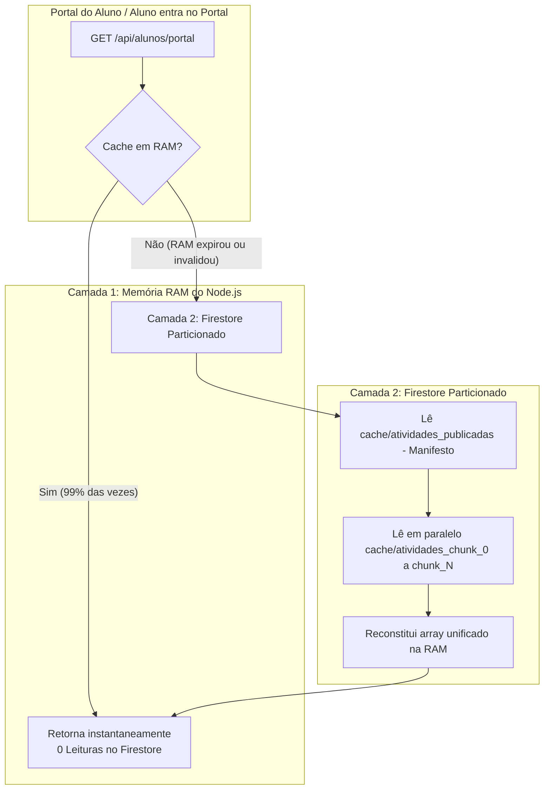

# ⚡ Arquitetura de Cache, CQRS e Consumo do Firestore

Este documento registra a estratégia técnica, o histórico de consumo, a modelagem CQRS e a arquitetura de cache particionado desenvolvida para garantir **alta performance com custo quase zero de leituras no Google Cloud Firestore**.

---

## 1. 📊 Histórico e Baseline de Consumo

### Baseline Inicial (05/08/2026)
* **Horário:** 07:28 AM (Início do dia letivo de testes/ajustes)
* **Estado:** Cotas do Firebase recém-resetadas.

| Métrica | Consumo Baseline | Limite Diário Gratuito | Margem Operacional |
| :--- | :--- | :--- | :--- |
| **Leituras (Reads)** | 0 | 50.000 / dia | 100% livre |
| **Gravações (Writes)** | 0 | 20.000 / dia | 100% livre |
| **Exclusões (Deletes)** | 0 | 20.000 / dia | 100% livre |

### O Problema Histórico de "Explosão de Leituras"
* **Diagnóstico:** Em ambientes serverless (Vercel/Next.js), cada recarregamento de página por um aluno gerava novas instâncias sem compartilhamento de memória física.
* Se 50 alunos entrassem no portal simultaneamente e cada um consultasse a coleção de atividades diretamente (832+ itens), o sistema consumia mais de **41.600 leituras em minutos**, quase esgotando o limite diário gratuito do Firebase.
* **Correções Aplicadas:**
  1. Cabeçalhos HTTP de Cache Control (`no-store, max-age=0, must-revalidate`) para evitar o atraso de 5 minutos da CDN/navegador, transferindo a inteligência de cache para o servidor.
  2. Implementação do padrão CQRS (`portal_views`).
  3. Cache consolidado no Firestore.

---

## 2. 🏛️ Padrão CQRS (portal_views)

Para evitar consultas relacionais pesadas de $O(N)$ em tempo real (como cruzar entregas, faltas, transações pix e badges), o sistema adota **CQRS (Command Query Responsibility Segregation)**:

1. **Escritas (Commands):**
   * Quando uma entrega é realizada, avaliada, devolvida ou estornada, a rota correspondente (`action-proxy`, `enviar-missao`, etc.) grava a entrega em `entregas` e atualiza instantaneamente o mapa consolidado no documento `portal_views/{matricula}`.
2. **Leituras (Queries):**
   * Ao abrir o portal (`/api/alunos/portal`), o sistema realiza **apenas 1 leitura cirúrgica** no documento `portal_views/{matricula}`, obtendo todas as entregas, presença, badges e notificações consolidadas sem percorrer coleções inteiras.

---

## 3. 🧩 Arquitetura de Cache Particionado (*Chunking*)

### O Limite de 1 MiB do Firestore
* O Google Firestore impõe um limite estrito de **1.048.576 bytes (1 MiB)** por documento.
* Com a publicação contínua de aulas ao longo do ano letivo (atingindo 832 atividades entre 1º e 2º ano), o antigo documento monolítico `cache/atividades_publicadas` atingiu **1.068.643 bytes**, fazendo com que novas aulas (como a Aula 47 e Aula 26) não conseguissem ser atualizadas.

### A Solução Definitiva: Particionamento em Chunks
Para eliminar qualquer teto futuro e suportar milhares de atividades escolares, o cache de atividades foi reestruturado em **duas camadas**:

### Especificação dos Documentos de Cache:
1. **Manifesto (`cache/atividades_publicadas`):**
   * Guarda metadados: `{ chunkCount: 6, totalAtividades: 832, updatedAt: "..." }`.
   * Mantém retrocompatibilidade automática com versões legadas enquanto o tamanho couber com segurança.
2. **Blocos de Dados (`cache/atividades_chunk_{i}`):**
   * Tamanho máximo por bloco: **150 atividades**.
   * Cada bloco pesa entre **150 KB e 220 KB** (muito abaixo do teto de 1 MB).
   * Suporta crescimento indefinido: quando atingir 1.000 ou 2.000 atividades, novos blocos são criados automaticamente.

### Consumo de Leituras Otimizado:
* **Sem cache:** 50 alunos $\times$ 832 atividades = **41.600 leituras**.
* **Com cache particionado (após expiração da RAM):** 1 manifesto + 6 chunks = **Apenas 7 leituras** *(Economia de 99,98%)*.
* **Em regime normal (memória RAM ativa):** **Zero leituras** no Firestore.
