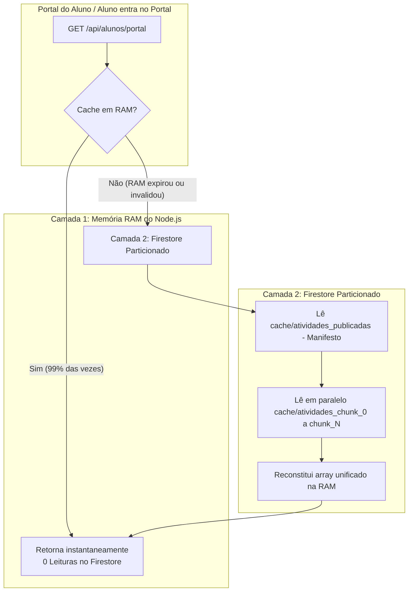

# ⚡ Arquitetura de Cache, CQRS e Consumo do Firestore

Este documento registra a estratégia técnica, o histórico de consumo, a modelagem CQRS e a arquitetura de cache particionado desenvolvida para garantir **alta performance com custo quase zero de leituras no Google Cloud Firestore**.

---

## 1. 📊 Histórico e Baseline de Consumo

### Baseline Inicial (05/08/2026)
* **Horário:** 07:28 AM (Início do dia letivo de testes/ajustes)
* **Estado:** Cotas do Firebase recém-resetadas.

| Métrica | Consumo Baseline | Limite Diário Gratuito | Margem Operacional |
| :--- | :--- | :--- | :--- |
| **Leituras (Reads)** | 0 | 50.000 / dia | 100% livre |
| **Gravações (Writes)** | 0 | 20.000 / dia | 100% livre |
| **Exclusões (Deletes)** | 0 | 20.000 / dia | 100% livre |

### O Problema Histórico de "Explosão de Leituras"
* **Diagnóstico:** Em ambientes serverless (Vercel/Next.js), cada recarregamento de página por um aluno gerava novas instâncias sem compartilhamento de memória física.
* Se 50 alunos entrassem no portal simultaneamente e cada um consultasse a coleção de atividades diretamente (832+ itens), o sistema consumia mais de **41.600 leituras em minutos**, quase esgotando o limite diário gratuito do Firebase.
* **Correções Aplicadas:**
  1. Cabeçalhos HTTP de Cache Control (`no-store, max-age=0, must-revalidate`) para evitar o atraso de 5 minutos da CDN/navegador, transferindo a inteligência de cache para o servidor.
  2. Implementação do padrão CQRS (`portal_views`).
  3. Cache consolidado no Firestore.

---

## 2. 🏛️ Padrão CQRS (portal_views)

Para evitar consultas relacionais pesadas de $O(N)$ em tempo real (como cruzar entregas, faltas, transações pix e badges), o sistema adota **CQRS (Command Query Responsibility Segregation)**:

1. **Escritas (Commands):**
   * Quando uma entrega é realizada, avaliada, devolvida ou estornada, a rota correspondente (`action-proxy`, `enviar-missao`, etc.) grava a entrega em `entregas` e atualiza instantaneamente o mapa consolidado no documento `portal_views/{matricula}`.
2. **Leituras (Queries):**
   * Ao abrir o portal (`/api/alunos/portal`), o sistema realiza **apenas 1 leitura cirúrgica** no documento `portal_views/{matricula}`, obtendo todas as entregas, presença, badges e notificações consolidadas sem percorrer coleções inteiras.

---

## 3. 🧩 Arquitetura de Cache Particionado (*Chunking*)

### O Limite de 1 MiB do Firestore
* O Google Firestore impõe um limite estrito de **1.048.576 bytes (1 MiB)** por documento.
* Com a publicação contínua de aulas ao longo do ano letivo (atingindo 832 atividades entre 1º e 2º ano), o antigo documento monolítico `cache/atividades_publicadas` atingiu **1.068.643 bytes**, fazendo com que novas aulas (como a Aula 47 e Aula 26) não conseguissem ser atualizadas.

### A Solução Definitiva: Particionamento em Chunks
Para eliminar qualquer teto futuro e suportar milhares de atividades escolares, o cache de atividades foi reestruturado em **duas camadas**:

### Especificação dos Documentos de Cache:
1. **Manifesto (`cache/atividades_publicadas`):**
   * Guarda metadados: `{ chunkCount: 6, totalAtividades: 839, includesRascunhos: true, maiorIdNumerico: 863, updatedAt: "..." }`.
   * Mantém retrocompatibilidade automática com versões legadas enquanto o tamanho couber com segurança.
2. **Blocos de Dados (`cache/atividades_chunk_{i}`):**
   * Tamanho máximo por bloco: **150 atividades**.
   * Cada bloco pesa entre **150 KB e 220 KB** (muito abaixo do teto de 1 MB).
   * Suporta crescimento indefinido: quando atingir 1.000 ou 2.000 atividades, novos blocos são criados automaticamente.

### Consumo de Leituras Otimizado:
* **Sem cache:** 50 alunos $\times$ 832 atividades = **41.600 leituras**.
* **Com cache particionado (após expiração da RAM):** 1 manifesto + 6 chunks = **Apenas 7 leituras** *(Economia de 99,98%)*.
* **Em regime normal (memória RAM ativa):** **Zero leituras** no Firestore.

---

## 4. 🛡️ Fase 2 de Blindagem de Cota (Otimização do Fluxo Docente, Singletons & Classroom em Lote)

### Diagnóstico de Telemetria (`monitor_leituras` — 28/10/2026)
A análise da telemetria em produção identificou que o **Portal do Aluno (`portal_views`)** já operava com consumo mínimo (**< 1% da cota diária**, ~283 leituras/dia), enquanto **86,5% do consumo diário (28.697+ leituras)** concentrava-se no fluxo administrativo do Tutor:
1. `GET /api/tutor/atividades` realizava varredura completa de `atividades` (~839 docs) + `estatisticas_atividades` (~857 docs) = **~1.696 leituras por chamada**, com TTL em memória de apenas 10s.
2. As ações `avaliar_entrega`, `reverter_entrega` e `excluir_entrega` disparavam `refreshFirestoreCacheAtividades(dbAdmin)` desnecessariamente (+839 leituras a cada avaliação de tarefa).
3. A criação e importação em lote (`salvar_atividade`) varria 839 documentos para gerar o ID sequencial `ATIV-XXX` e reconstruía os chunks a cada item do lote.
4. O `sincronizar-ava` lia `atividades` inteira (~839 docs) e fazia 1 chamada HTTP sequencial na API do Google Classroom por atividade (~800 requisições HTTP), levando ~7 minutos.
5. As telas de `diario-classe`, `frequencia-hoje`, `transacoes`, `rifas` e modais de `buscar_entregas_atividade` / `verificar_regras_fechamento` não compartilhavam cache em memória e reconsultavam o banco a cada troca de aba.
6. Em ambiente de desenvolvimento (`npm run dev`), o *monkey-patch* de telemetria em [`src/lib/firebaseAdmin.ts`](file:///c:/Users/Mario%20Renan/OneDrive/Área%20de%20Trabalho/painel-erem/src/lib/firebaseAdmin.ts) era empilhado múltiplas vezes durante recompilações de rotas, inflando artificialmente o contador `monitor_leituras`.

### Arquitetura da Solução Implementada e Validada
1. **Unificação dos Chunks de Atividades (Aluno + Tutor) & Resumo de Estatísticas:**
   * Os blocos `cache/atividades_chunk_{i}` armazenam todas as atividades (`Publicada` e `Rascunho`) com todos os metadados (`respostaCorreta`, `resolucaoTyping`, `limiteTempoTyping`, `linkClassroom`, etc.).
   * **Filtro de Segurança por Perfil:**
     * `GET /api/alunos/portal`: Filtra estritamente `statusPublicacao === "Publicada"` e omite `respostaCorreta` antes de enviar ao cliente.
     * `GET /api/tutor/atividades`: Lê os mesmos chunks (**7 leituras** no *cold start* ou **0 em RAM**, em vez de 839) e mantém visibilidade total de rascunhos e gabaritos.
   * **Singleton de Contadores (`cache/estatisticas_atividades_resumo`):** Consolida os contadores `{ pendentes, aguardandoValidacao, validadasAVA }` em um único documento (~50 KB para 850 atividades), atualizado atomicamente via `FieldValue.increment` em todas as rotas de submissão/avaliação, reduzindo 857 leituras para **1 leitura**.
2. **Desacoplamento de Avaliação vs. Cache Estrutural de Atividades:**
   * `refreshFirestoreCacheAtividades(dbAdmin)` é executado exclusivamente quando a **estrutura da missão** é alterada (`salvar_atividade`, `excluir_atividade`, `toggle_gabarito`, `salvar_gabaritos_lote`, ou auto-publicação via `sincronizar-ava`).
   * Avaliações de entregas atualizam `portal_views/{matricula}` e `cache/estatisticas_atividades_resumo` sem reler a coleção `atividades`.
3. **Geração de ID $O(1)$ e Importação em Lote (`skipCacheRefresh`):**
   * O maior número sequencial `ATIV-XXX` é obtido via `getNextAtividadeId(dbAdmin)` a partir do manifesto `cache/atividades_publicadas` (`maiorIdNumerico`) ou do cache em memória, sem varrer a coleção `atividades`.
   * Na importação em lote do Radar Classroom, `refreshFirestoreCacheAtividades` roda apenas no último item do lote.
4. **Sincronia de Singletons (`configuracoes_gerais` e `cache_alunos_geral_0`) e Caches L1 do Painel Docente:**
   * `refreshAlunosAtivosSnapshot(dbAdmin)` mantém `metadata/cache_alunos_geral_0` sincronizado e em cache RAM (`alunosAtivosSnapshotRamCache`) sempre que a secretaria ou o tutor cadastrar, editar, ativar/inativar ou graduar estudantes.
   * `cache/configuracoes_gerais` é compartilhado entre `/api/alunos/portal`, `/api/configuracoes` e `/api/tutor/senha-checkin` (**1 leitura** no *cold start* / **0 em RAM**).
   * Caches em RAM dedicados (`getCachedFrequencia`, `getCachedTransacoesRecentes`, `getCachedRifas`, `getCachedRankingAlunosAtivos`) e consulta direta por `timestamp` em `diario-classe` zeram leituras repetidas na navegação entre abas do painel docente.
5. **Radar Classroom Organizado (`DRAFT` + `PUBLISHED`) & Sincronização AVA em Lote (`courseWorkId: "-"`):**
   * O **Radar Classroom** escaneia tanto `PUBLISHED` quanto `DRAFT` no Google Classroom (filtrando links já existentes via `loadFirestoreCacheAtividades`), exibindo abas (`Publicadas`, `Rascunhos`, `Todas`), busca instantânea, ordenação por número de aula e pré-seleção segura apenas das publicadas.
   * Rascunhos do AVA importados como `statusPublicacao: "Rascunho"` permitem pré-configurar o [`CodingPractice.tsx`](file:///c:/Users/Mario%20Renan/OneDrive/Área%20de%20Trabalho/painel-erem/src/components/CodingPractice.tsx) antes da aula e são promovidos automaticamente para `"Publicada"` no `sincronizar-ava` assim que publicados no Classroom.
   * O `POST /api/tutor/sincronizar-ava` lê o catálogo de atividades do cache particionado (**0 a 7 leituras**), pula missões ainda em `DRAFT` em `0ms`, e utiliza busca paginada em lote (`courseWorkId: "-"`, `states: ["TURNED_IN", "RETURNED"]`) quando há mais de 4 atividades por curso, reduzindo o tempo de sincronização global e mantendo o consumo do Firestore em ~44 leituras para todas as turmas.
6. **Proteção de Telemetria (`firestoreMonkeyPatched`):**
   * Adicionada flag global `globalForFirebase.firestoreMonkeyPatched` em [`src/lib/firebaseAdmin.ts`](file:///c:/Users/Mario%20Renan/OneDrive/Área%20de%20Trabalho/painel-erem/src/lib/firebaseAdmin.ts) garantindo que `Query.prototype.get` e `DocumentReference.prototype.get` sejam instrumentados uma única vez por processo.
