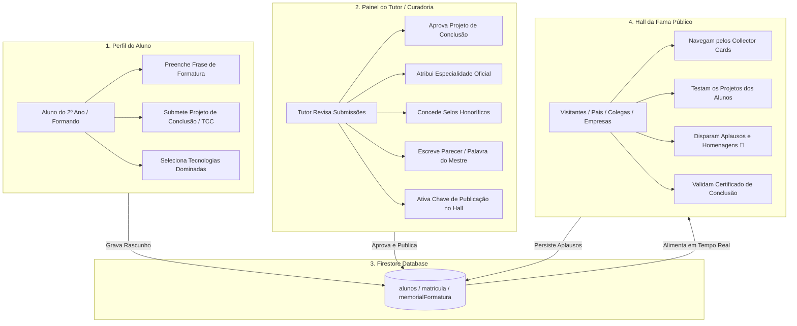

# 🏛️ Arquitetura e Roadmap: Hall da Fama (Trilha Tech)

Este documento registra a **arquitetura lógica completa**, o **modelo de dados**, os **contratos de API** e o **roadmap passo a passo** do **Hall da Fama** da Trilha Tech (EREM).

Ele serve como o guia definitivo para saber:
1. **Onde o projeto começou.**
2. **O que já está implementado e funcional.**
3. **Onde paramos e de onde devemos continuar.**

---

## 📌 Status Atual do Projeto (Tracking)

| Etapa | Componente / Funcionalidade | Status | Arquivo Principal |
| :--- | :--- | :---: | :--- |
| **Design** | Mockups Visuais Conceituais (UI de Alta Fidelidade) | ✅ Concluído | `hall_formandos_conquistas_*.jpg` |
| **Frontend** | Página Pública do Hall da Fama (`/hall-da-fama`) | ✅ Concluído | `src/app/hall-da-fama/page.tsx` |
| **Frontend** | Pódio 3D, Collector Cards, Filtros e Botão de Aplausos | ✅ Concluído | `src/app/hall-da-fama/page.tsx` |
| **Frontend** | Hero Banner de Destaque no Dashboard do Aluno | ✅ Concluído | `src/app/portal/page.tsx` |
| **Etapa 1** | Modelagem de Dados no Firestore (`memorialFormatura` & `certificacoesTech`) | ✅ Concluído | `src/types/index.ts` |
| **Etapa 1** | Aba "Memorial de Formatura" no Perfil do Aluno | ✅ Concluído | `src/components/MemorialTab.tsx` & `PerfilModal.tsx` |
| **Etapa 1** | Rotas de API do Memorial (Foto, Frase, TCC & Quiz) | ✅ Concluído | `src/app/api/alunos/memorial/route.ts` |
| **Etapa 1** | Banco de Questionários Técnicos (10 Questões • Nota $\ge 7$) | ✅ Concluído | `src/lib/questionariosTech.ts` |
| **Etapa 1** | Persistência Real de Aplausos Diários Autenticados (1/dia) | ✅ Concluído | `src/app/api/hall-da-fama/aplaudir/route.ts` |
| **Etapa 2** | Aba/Modal "Curadoria do Hall da Fama" no Painel do Tutor | ✅ Concluído | `src/components/CuradoriaHallModal.tsx` & `src/app/trilhatech/page.tsx` |
| **Etapa 2** | API do Tutor para aprovação, selos de honra e parecer | ✅ Concluído | `src/app/api/tutor/memorial/curadoria/route.ts` |
| **Etapa 3** | Modal de Certificado Digital Verificável | ⏳ Pendente | `src/components/CertificadoModal.tsx` |
| **Etapa 3** | Gerador de Card para Story (Instagram/WhatsApp) | ⏳ Pendente | `src/components/CardCompartilharModal.tsx` |

---

## 🏗️ Os 3 Lados da Arquitetura Lógica



---

## 💾 Modelo de Dados no Firestore (`MemorialFormatura`)

O objeto `memorialFormatura` é incorporado diretamente no documento do aluno em `alunos/{matricula}`:

```typescript
export interface ProjetoConclusao {
  titulo: string;
  descricao: string;
  linkDeploy?: string;     // URL da aplicação funcionando (Vercel, etc.)
  linkGithub?: string;     // Repositório de código
  aprovadoPeloTutor: boolean;
}

export interface CertificacaoTech {
  tech: string;             // ex: "React", "TypeScript", "Python"
  nota: number;             // 0 a 10 (calculada pelo backend)
  aprovado: boolean;        // nota >= 7.0
  dataTeste: number;        // timestamp
  tentativas: number;
  badgeConcedida: string;   // ex: "⚛️ React Specialist"
}

export interface MemorialFormatura {
  // === 1. Preenchido pelo Aluno ===
  fraseFormatura: string;
  techStack: string[];              // apenas tecnologias com certificação nota >= 7
  fotoUrl?: string;                 // foto de formatura ou avatar temático
  certificacoesTech?: CertificacaoTech[];
  projetoDestaque: ProjetoConclusao;
  linkedinUrl?: string;
  githubUrl?: string;

  // === 2. Curadoria Exclusiva do Tutor ===
  especialidadeOficial: string;     // ex: "Arquiteta de Sistemas", "Líder em IA"
  seloHonorifico?: string;          // ex: "Top 1 Geral", "Guardião da Presença", "Inovador do Ano"
  parecerTutor?: string;            // Palavra de homenagem do professor
  publicadoNoHall: boolean;         // true = Visível publicamente

  // === 3. Métricas Consolidadas de Formatura ===
  anoFormacao: number;              // ex: 2026
  xpFinal: number;                  // XP congelado na formatura
  nivelFinal: string;               // ex: "Dev Supremo"
  totalAplausos: number;            // Quantidade de aplausos da comunidade
  dataGraduacao?: number;           // Timestamp
}
```

---

## 🔌 Especificação dos Contratos de API

### 1. Rota do Aluno: `GET /api/alunos/memorial`
* **Query:** `?matricula=XXXXX`
* **Query alternativa (Quiz):** `?action=perguntas&tech=React` (retorna as 10 perguntas sem gabarito)
* **Função:** Retorna os dados do memorial, foto, status de curadoria e histórico de certificações teóricas.

### 2. Rota do Aluno: `POST /api/alunos/memorial`
* **Ação 1: Salvar Memorial / Foto**
  ```json
  {
    "action": "salvar_memorial",
    "matricula": "3826381",
    "fotoUrl": "https://api.dicebear.com/9.x/bottts/svg?seed=GraduationGold",
    "fraseFormatura": "A persistência no código é a ponte entre o bug e a inovação.",
    "projetoDestaque": {
      "titulo": "Portal Educacional Gamificado",
      "descricao": "Sistema completo para gestão de frequência e gamificação.",
      "linkDeploy": "https://meuprojeto.vercel.app",
      "linkGithub": "https://github.com/aluno/projeto"
    },
    "linkedinUrl": "https://linkedin.com/in/aluno",
    "githubUrl": "https://github.com/aluno"
  }
  ```
* **Ação 2: Submeter Questionário Técnico de Linguagem**
  ```json
  {
    "action": "submeter_teste",
    "matricula": "3826381",
    "tech": "React",
    "respostas": { "1": 1, "2": 2, "3": 0, "4": 2, ... }
  }
  ```
* **Regra de Negócio:** Se a nota for $\ge 7/10$ ($\ge 70\%$), a tecnologia é aprovada pelo backend, incluída em `techStack` e a badge correspondente é concedida no card do Hall da Fama!

### 3. Rota de Aplauso Autenticado: `POST /api/hall-da-fama/aplaudir`
* **Body:**
  ```json
  {
    "matriculaDestinatario": "3826381",
    "matriculaRemetente": "3756187"
  }
  ```
* **Regras de Negócio:**
  1. Apenas usuários conectados/logados podem aplaudir (visitantes recebem convite de login).
  2. Limite estrito de 1 aplauso por dia por formando (auditoria em `aplausos_memorial`).
  3. Não é permitido aplaudir a si mesmo.
  4. Incremento atômico no Firestore via `FieldValue.increment(1)`.

### 4. Rota do Tutor: `POST /api/tutor/memorial/curadoria`
* **Body:**
  ```json
  {
    "matricula": "3826381",
    "especialidadeOficial": "Especialista em Gamificação & Lógica Web",
    "seloHonorifico": "Top Honra • Destaque em Superação",
    "parecerTutor": "Otávio demonstrou evolução fantástica e resiliência impecável.",
    "aprovadoProjeto": true,
    "publicadoNoHall": true
  }
  ```

---

## 🗺️ Roadmap de Execução (Onde Continuar)

### ✅ Etapa 1: O Lado do Aluno (Concluída)
1. Tipos `ProjetoConclusao`, `CertificacaoTech` e `MemorialFormatura` em [`src/types/index.ts`](file:///c:/Users/Mario%20Renan/OneDrive/Área%20de%20Trabalho/painel-erem/src/types/index.ts).
2. Rota de API [`src/app/api/alunos/memorial/route.ts`](file:///c:/Users/Mario%20Renan/OneDrive/Área%20de%20Trabalho/painel-erem/src/app/api/alunos/memorial/route.ts) com questionário técnico (10 questões, nota mínima $\ge 7$) e sanitização contra campos `undefined`.
3. Aba **"🎓 Memorial de Formatura"** em [`src/components/MemorialTab.tsx`](file:///c:/Users/Mario%20Renan/OneDrive/Área%20de%20Trabalho/painel-erem/src/components/MemorialTab.tsx) & [`src/components/PerfilModal.tsx`](file:///c:/Users/Mario%20Renan/OneDrive/Área%20de%20Trabalho/painel-erem/src/components/PerfilModal.tsx).

### ✅ Etapa 2: O Lado do Tutor — Curadoria e Publicação (Concluída — Em Validação Local)
1. Rota de API [`src/app/api/tutor/memorial/curadoria/route.ts`](file:///c:/Users/Mario%20Renan/OneDrive/Área%20de%20Trabalho/painel-erem/src/app/api/tutor/memorial/curadoria/route.ts) com preservação de imutabilidade (`xpFinal`/`nivelFinal` para Veteranos), higienização de propriedades `undefined` e notificação no `portal_views`.
2. Modal de Curadoria [`src/components/CuradoriaHallModal.tsx`](file:///c:/Users/Mario%20Renan/OneDrive/Área%20de%20Trabalho/painel-erem/src/components/CuradoriaHallModal.tsx) integrado ao painel [`src/app/trilhatech/page.tsx`](file:///c:/Users/Mario%20Renan/OneDrive/Área%20de%20Trabalho/painel-erem/src/app/trilhatech/page.tsx) (atualização otimista em estado local sem re-leitura de documentos).
3. Soberania estrita de `publicadoNoHall === true` em [`src/app/api/alunos/veteranos/route.ts`](file:///c:/Users/Mario%20Renan/OneDrive/Área%20de%20Trabalho/painel-erem/src/app/api/alunos/veteranos/route.ts) e [`src/app/hall-da-fama/page.tsx`](file:///c:/Users/Mario%20Renan/OneDrive/Área%20de%20Trabalho/painel-erem/src/app/hall-da-fama/page.tsx) (remoção de mockups forçados quando desativado pelo tutor + cache em memória `getCachedVeteranos` em [`src/lib/cache.ts`](file:///c:/Users/Mario%20Renan/OneDrive/Área%20de%20Trabalho/painel-erem/src/lib/cache.ts)).

### 🏛️ Etapa 3: Próximo Passo (A Construir Após Validação da Etapa 2)
1. **Checklist de Validação Pré-Etapa 3:**
   - [ ] Validar ativação e desativação individual de formandos (`Publicar no Hall`) no ambiente local e confirmar reflexo imediato em `/hall-da-fama`.
   - [ ] Validar exibição da *Palavra do Mestre* (`parecerTutor`) e dos links de *Projeto Aprovado* (`projetoDestaque.aprovadoPeloTutor`) nos Collector Cards.
   - [ ] Fazer commit e push da Etapa 2 após aprovação final do tutor.
2. **Construção da Etapa 3:**
   - [ ] Criar o modal de **Certificado Digital Verificável** (`src/components/CertificadoModal.tsx`) com design oficial e opção de impressão/PDF.
   - [ ] Criar o gerador de **Card para Story (Instagram/WhatsApp/LinkedIn)** (`src/components/CardCompartilharModal.tsx`).

---

## 📜 Regras para Agentes e Desenvolvedores
* **Tipagem Estrita:** Proibido o uso de `any` conforme [`.agents/AGENTS.md`](file:///c:/Users/Mario%20Renan/OneDrive/Área%20de%20Trabalho/painel-erem/.agents/AGENTS.md).
* **Idempotência e Segurança:** Ações que concedem selos ou publicam dados devem ser atômicas.
* **Preservação de Histórico:** O XP e os níveis dos formandos devem ser preservados para consulta perpétua mesmo após o encerramento do ano letivo.
